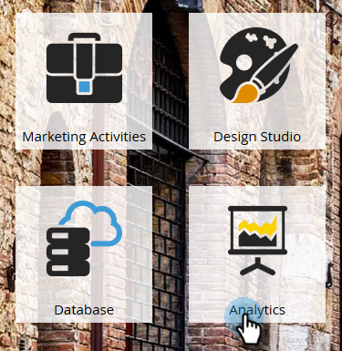
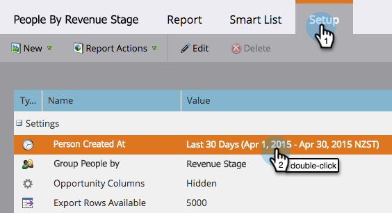
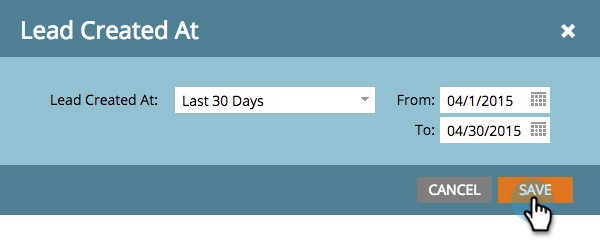
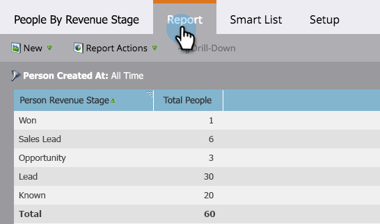

# Rapport Personnes par étape du cycle de revenus {#people-by-revenue-stage-report}

Vous pouvez créer un rapport indiquant à quelle étape de votre modèle de cycle du chiffre d&#39;affaires vos salariés se trouvent. L&#39;état inclut toutes les étapes du modèle spécifié tant qu&#39;il existe un solde de personnes pour la période donnée de l&#39;état.

>[!AVAILABILITY]
>
>Toutes les éditions de Marketo n’incluent pas cette fonctionnalité. Contactez votre gestionnaire de compte pour plus d’informations.

1. Accédez à **[!UICONTROL Analytics]**.

   

1. Cliquez sur le rapport **[!UICONTROL Personnes par étape de chiffre d’affaires]**.

   

1. Cliquez sur l’onglet **[!UICONTROL Configuration]**. Double-cliquez sur le champ **[!UICONTROL Personne créée à]** pour définir la période sur laquelle portera le rapport.

   

1. Modifiez la période et cliquez sur **[!UICONTROL Enregistrer]**.

   

1. Cliquez sur l’onglet **[!UICONTROL Rapport]**. Vous pouvez maintenant voir à quelle étape de votre modèle de revenus vos employés se trouvent et vous concentrer sur les goulots d&#39;étranglement.

   
