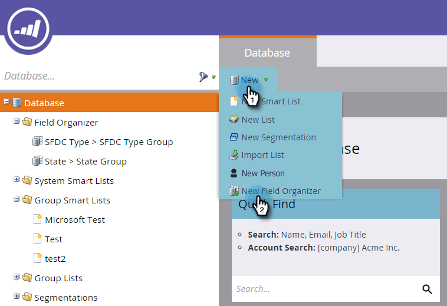
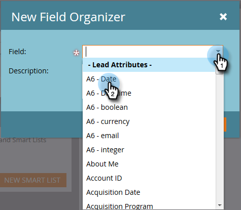
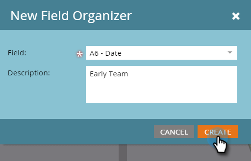
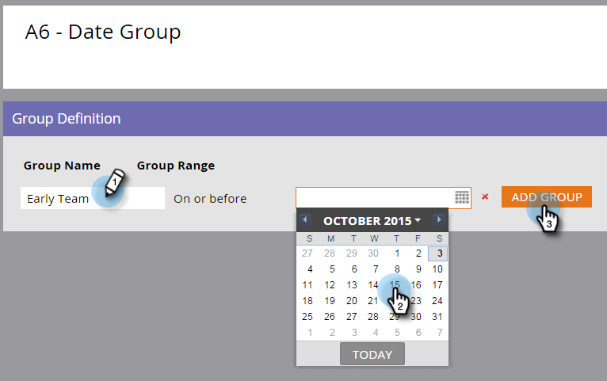

# Utilisation des organisateurs de champs {#using-field-organizers}

Les organisateurs de champs vous permettent de spécifier certains champs parmi toutes les valeurs possibles. Par exemple, vous pouvez créer des regroupements significatifs, tels que Côte Ouest et Côte Est, pour le champ Territoire. Cela permet aux rapports de s’exécuter plus rapidement.

Les organisateurs de champ sont similaires aux segmentations, qui sont utilisées de manière générique, mais les organisateurs de champ sont utilisés pour la création de rapports au niveau du champ.

Vous pouvez avoir jusqu’à trois segmentations personnalisées dans une liste de champs.

Il n’existe aucun rapport spécifique sur les organisateurs de champs.

Les organisateurs de champ sont utilisés dans l’analyse des performances du modèle.

## Comment créer des organisateurs de champ {#how-to-create-field-organizers}

1. Cliquez sur **[!UICONTROL Base de données]**.

   

1. Sous **[!UICONTROL Nouveau]**, sélectionnez **[!UICONTROL Nouvel organisateur de champ]**.

   

1. Sous **[!UICONTROL Champ]**, sélectionnez un attribut. Description facultative.

   

1. Cliquez sur **[!UICONTROL Créer]**.

   

1. Nommez le groupe et saisissez les données appropriées (cela dépendra du type de données du champ sélectionné). Cliquez sur **[!UICONTROL Ajouter un groupe]**.

   

Créez d’autres organisateurs de champs de la même manière, si vous en avez besoin. Et voilà.

>[!MORELIKETHIS]
>
>[Créer des groupes de champs personnalisés à l’aide de l’organisateur de champs](/help/marketo/product-docs/reporting/revenue-cycle-analytics/revenue-tools/field-organizers/create-custom-field-groups-using-the-field-organizer.md)
