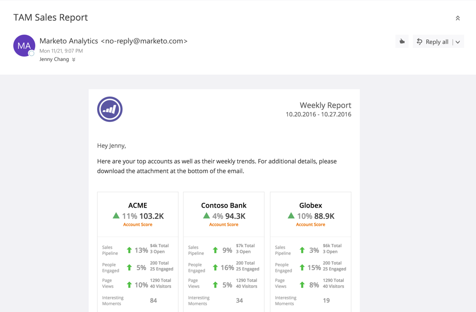

# Rapport des ventes TAM {#tam-sales-report}

Recevez un e-mail hebdomadaire contenant vos principaux comptes et leurs tendances hebdomadaires.

>[!NOTE]
>
>Découvrez comment configurer ce rapport [ici](/help/marketo/product-docs/target-account-management/measure/tam-report-setup.md).

Le rapport partage :

* Comptes nommés triés selon le score du compte choisi
* Personnes les plus engagées
* Tendances clés et moments intéressants
* Un lien pour télécharger un fichier CSV contenant des détails supplémentaires

## Clé du rapport des ventes {#sales-report-key}

<table>
 <tbody>
  <tr>
   <td><strong>Score du compte</strong></td>
   <td>
    

      Tendance hebdomadaire par score du compte (sélectionné dans la configuration), suivi du score du compte actuel
    
</td>
  </tr>
  <tr>
   <td><strong>Pipeline de ventes</strong></td>
   <td>
    

      Tendance hebdomadaire par pipeline, suivie du pipeline actuel total et du nombre d’opportunités ouvertes
    
</td>
  </tr>
  <tr>
   <td><strong>Pages vues</strong></td>
   <td>
    

      Tendance hebdomadaire des pages vues, suivie du nombre total de pages vues et du nombre de visiteurs uniques
    
</td>
  </tr>
  <tr>
   <td><strong>Moments intéressants</strong></td>
   <td>
    

      Nombre total de moments intéressants survenus au cours de la semaine
    
</td>
  </tr>
 </tbody>
</table>
