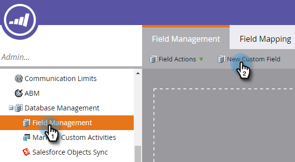
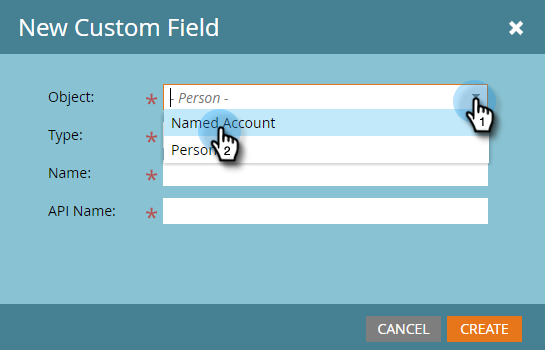
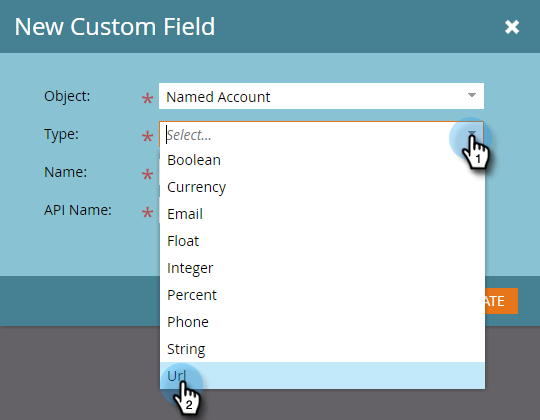
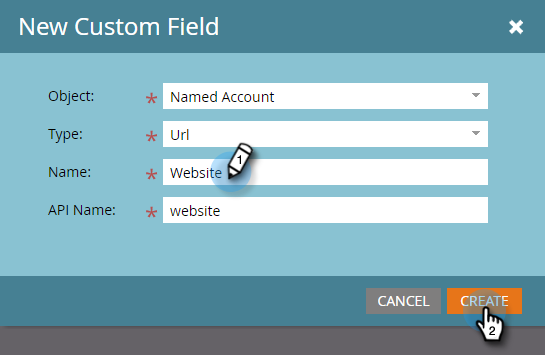
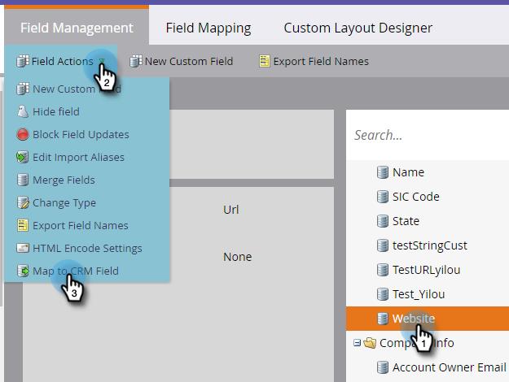
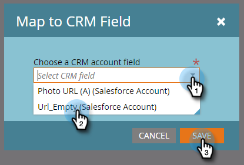
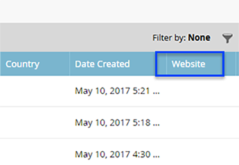

# Créer un champ personnalisé pour la découverte GRC {#create-a-custom-field-for-crm-discovery}

Ajoutez des champs personnalisés aux comptes, mappez-les à votre CRM et utilisez-les pour la découverte de compte CRM dans Marketo.

1. Cliquez sur **[!UICONTROL Admin]**.

   

1. Cliquez sur **[!UICONTROL Gestion des champs]**, puis sur **[!UICONTROL Nouveau champ personnalisé]**.

   

1. Cliquez sur la liste déroulante **[!UICONTROL Objet]** et sélectionnez **[!UICONTROL Compte nommé]**.

   

1. Cliquez sur le menu déroulant **[!UICONTROL Type]** et sélectionnez un type.

   

1. Saisissez un **[!UICONTROL Nom]** (le nom de l’API sera renseigné automatiquement) et cliquez sur **[!UICONTROL Créer]**.

   

1. Une fois le champ créé, sélectionnez-le dans l’arborescence de droite. Cliquez sur la liste déroulante **[!UICONTROL Actions de champ]** et sélectionnez **[!UICONTROL Mapper au champ CRM]**.

   

1. Sélectionnez le champ Compte CRM à mapper et cliquez sur **[!UICONTROL Enregistrer]**.

   

   Une fois synchronisé, votre nouveau champ apparaîtra à l’extrême droite de votre grille Discover CRM.

   
