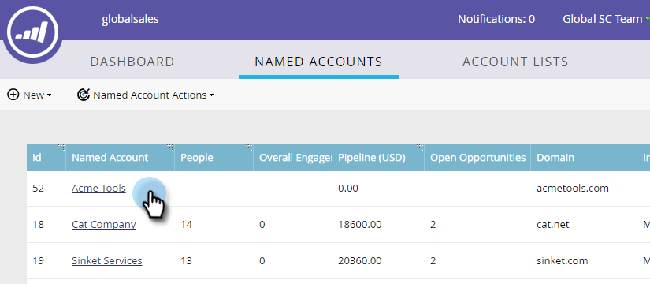
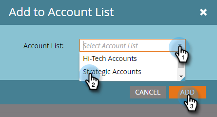

# Ajout d’un [!UICONTROL Compte nommé] existant à une liste de comptes {#add-an-existing-named-account-to-an-account-list}

L’ajout d’un compte nommé à une liste de comptes est simple.

>[!NOTE]
>
>Cela s’applique uniquement aux listes de comptes, **pas** aux listes de comptes dynamiques.

1. Sélectionnez la ligne du compte nommé auquel vous souhaitez ajouter des données.

   

1. Cliquez sur le menu déroulant **[!UICONTROL Actions de compte nommées]** et sélectionnez **[!UICONTROL Ajouter à la liste des comptes]**.

   

1. Cliquez sur la liste déroulante **[!UICONTROL Liste des comptes]**, sélectionnez la liste des comptes souhaitée, puis cliquez sur **[!UICONTROL Ajouter]**.

   

>[!MORELIKETHIS]
>
>[Créer un [!UICONTROL compte nommé]](/help/marketo/product-docs/target-account-management/target/named-accounts/create-a-named-account.md)
