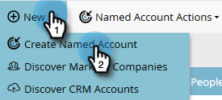
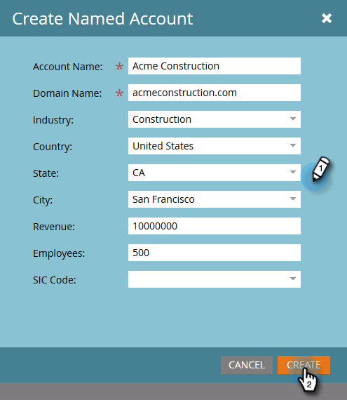

# Créez un [!UICONTROL Compte nommé] {#create-a-named-account}

Pour créer manuellement un compte nommé, procédez comme suit.

1. Dans [!UICONTROL Comptes nommés], cliquez sur le menu déroulant **[!UICONTROL Nouveau]** et sélectionnez **[!UICONTROL Créer un compte nommé]**.

   

1. Renseignez les champs de votre choix et cliquez sur **[!UICONTROL Créer]**.

   

   >[!TIP]
   >
   >Cliquez directement sur un compte nommé pour afficher son tableau de bord.

>[!MORELIKETHIS]
>
>[Ajouter des personnes à un [!UICONTROL Compte nommé]](/help/marketo/product-docs/target-account-management/target/named-accounts/add-people-to-a-named-account.md)
