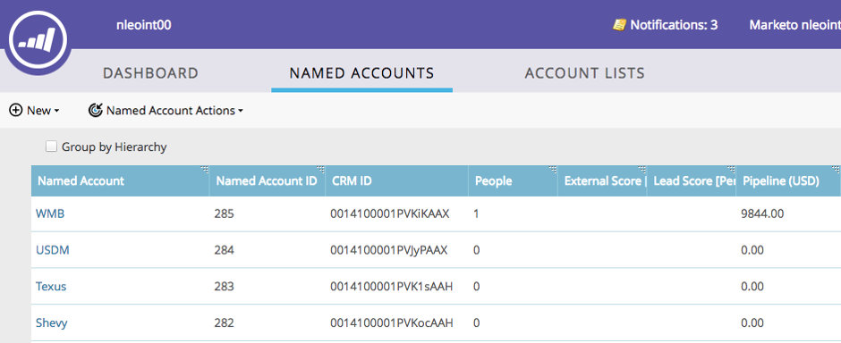
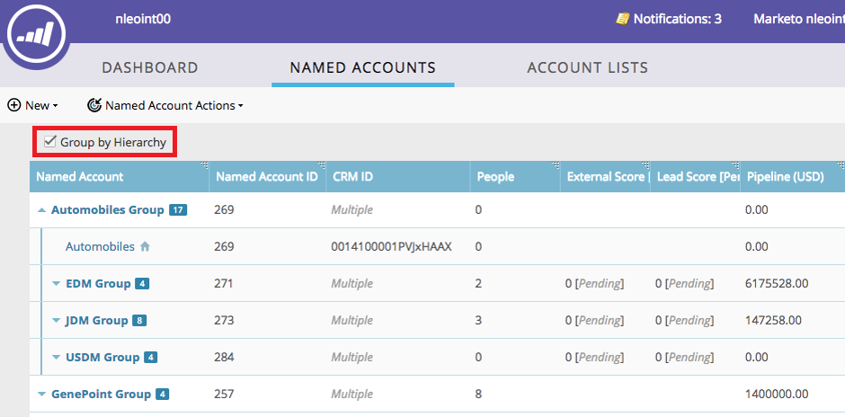
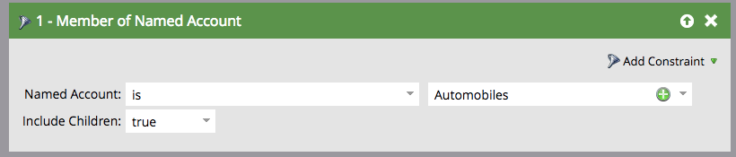

# Hiérarchies TAM {#tam-hierarchies}

Les hiérarchies permettent aux utilisateurs de TAM d’hériter des relations parent/enfant entre les [!UICONTROL comptes nommés] dans leur CRM.

## Que sont les hiérarchies de TAM ? {#what-are-tam-hierarchies}

Les entreprises peuvent avoir plusieurs divisions et filiales. Ces entreprises s&#39;organisent souvent par le biais de relations parents-enfants appelées hiérarchies. TAM peut hériter de ces hiérarchies à partir de votre intégration SFDC ou MSD et vous permettre de travailler avec les différentes divisions comme une seule famille.

## Utilisation des hiérarchies de gestion des balises {#working-with-tam-hierarchies}

Grâce aux hiérarchies de TAM, vous pouvez obtenir rapidement des informations sur une hiérarchie complète ou des comptes individuels dans le tableau de bord [!UICONTROL Compte nommé].

**Sans utiliser la hiérarchie**

**Utilisation de la hiérarchie**

>[!NOTE]
>
>L’interface Marketo n’affiche que 10 niveaux maximum vers le bas (comptes enfants et petits-enfants du compte parent). Toutefois, vous pouvez créer un nombre illimité de comptes enfants.

Ciblez et générez des rapports sur des hiérarchies entières en [un clic](/help/marketo/product-docs/target-account-management/engage/account-filters.md#member-of-named-account).

