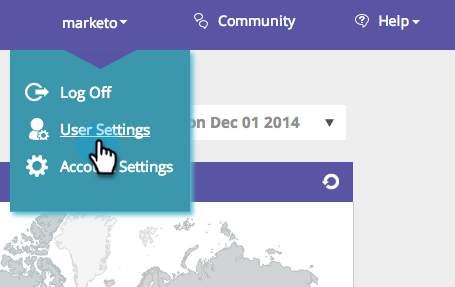
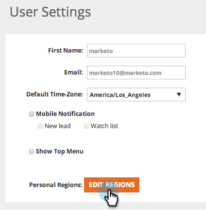

# [!UICONTROL Modifier les régions] {#edit-regions}

Vous souhaitez modifier vos paramètres régionaux utilisateur pour n’afficher que les données de votre région spécifique ?

1. Accédez à **[!UICONTROL Paramètres utilisateur]**.

   

1. Cliquez sur **[!UICONTROL Modifier les régions]**.

   

1. Vérifiez vos pays ou états associés à votre région.

>[!NOTE]
>
>Si vous sélectionnez États-Unis, toutes les options États-Unis s’ouvrent au bas de la page.
