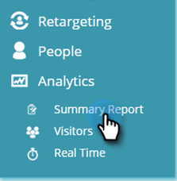
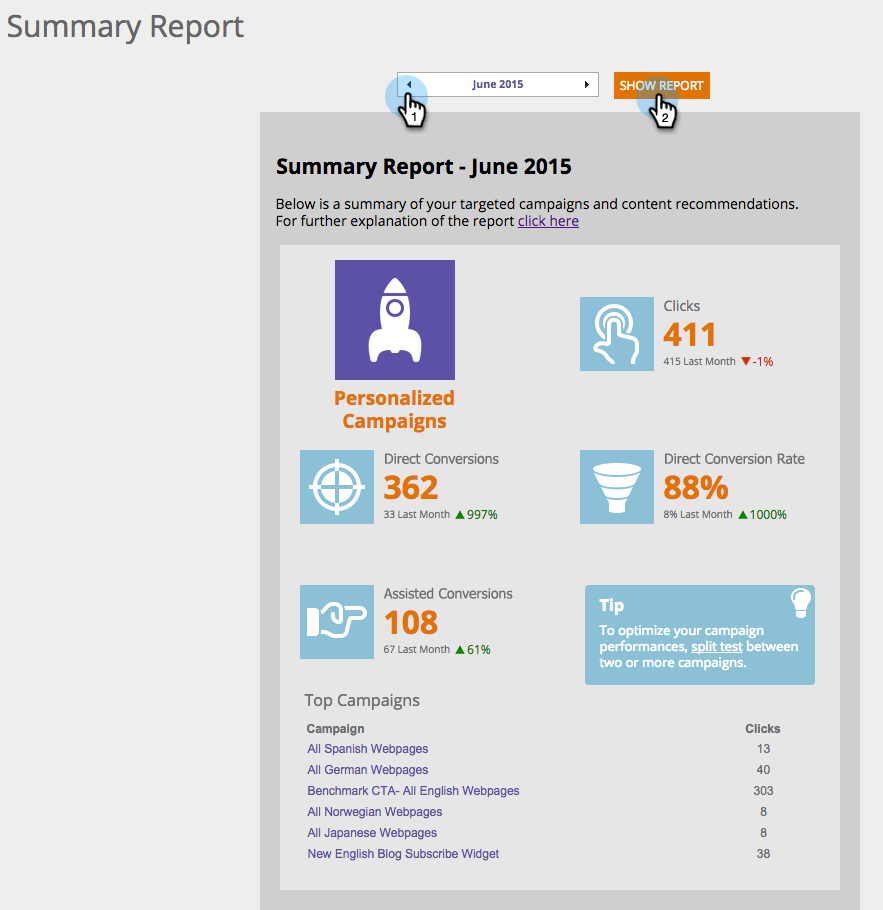

# Comprendre le [!UICONTROL rapport récapitulatif] {#understanding-the-summary-report}

Le [!UICONTROL rapport récapitulatif] est une vue mensuelle de toutes les campagnes et des performances de contenu recommandées. Elle est basée sur le nombre de clics et le nombre de leads (directs ou assistés) qui ont interagi avec la campagne personnalisée ou le contenu recommandé, puis sont devenus un lead connu. Le rapport compare les résultats au mois précédent.

>[!NOTE]
>
>**Définition**
>
>Conversion directe : un visiteur web qui clique sur une campagne personnalisée ou une ressource de contenu recommandée et qui, au cours de la même session de visite, remplit n’importe quel formulaire du site web avec son adresse e-mail.
>
>Conversion assistée : visiteur web qui remplit n’importe quel formulaire du site web et laisse son adresse e-mail, qui, lors d’une visite précédente (au cours des 6 derniers mois), a cliqué sur une campagne personnalisée ou une ressource de contenu recommandée.

Dans [!UICONTROL Web Personalization], accédez à **[!UICONTROL Analytics]** et **[!UICONTROL Summary Report]**.

Sélectionnez **Mois** et cliquez sur **[!UICONTROL Afficher le rapport]**.

La première partie du rapport concerne les campagnes et affichages personnalisés de Web Personalization :

* **[!UICONTROL Clics]** - tous les clics sur les campagnes Web Personalization
* **[!UICONTROL Conversions directes]** - tous les visiteurs et visiteuses qui ont cliqué sur une campagne Web Personalization au cours de la visite et rempli un formulaire
* **[!UICONTROL Taux de conversion direct]** - Pourcentage de visiteurs et visiteuses qui sont devenus des prospects directs après avoir cliqué sur une campagne Web Personalization. Prospects directs divisés par les clics
* **[!UICONTROL Conversions assistées]** - tous les visiteurs et visiteuses qui ont rempli un formulaire et cliqué sur une campagne Web Personalization lors d’une visite précédente (au cours des 6 derniers mois)
* **[!UICONTROL Conseil]** - conseils pour optimiser les performances de vos campagnes Web Personalization
* **[!UICONTROL Campagnes les plus performantes]** - les campagnes les plus performantes au cours de la période sélectionnée, classées par nombre de clics

La deuxième partie du rapport concerne le moteur de recommandation de contenu Recommandé à partir de Web Personalization. Elle affiche :

* **[!UICONTROL Clics]** - tous les clics sur le contenu recommandé de Web Personalization
* **[!UICONTROL Conversions directes]** - tous les visiteurs et visiteuses qui ont cliqué sur le contenu recommandé au cours de leur visite et ont rempli un formulaire
* **[!UICONTROL Taux de conversion direct]** - pourcentage de visiteurs et visiteuses qui sont devenus un prospect direct après avoir cliqué sur le contenu recommandé. Prospects directs divisés par les clics
* **[!UICONTROL Conversions assistées]** - tous les visiteurs et visiteuses qui ont rempli un formulaire et cliqué sur le contenu recommandé lors d’une visite précédente (au cours des 6 derniers mois)
* **[!UICONTROL Conseil]** - conseils pour une optimisation à l’aide du moteur de recommandation de contenu
* **[!UICONTROL Meilleures recommandations]** - contenu recommandé le plus performant au cours de la période sélectionnée, trié par nombre de clics

>[!NOTE]
>
>Marketo Web Personalization capture l’adresse e-mail du visiteur web pour tout formulaire rempli sur le site web. Affiché dans la page Prospects de Web Personalization, il s’agit du prospect utilisé dans le rapport récapitulatif.
