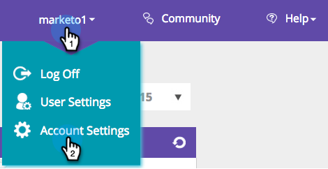
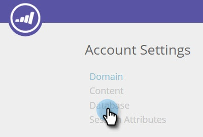
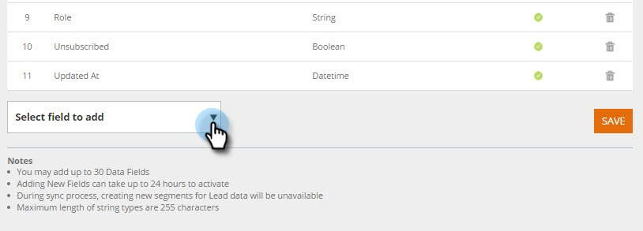
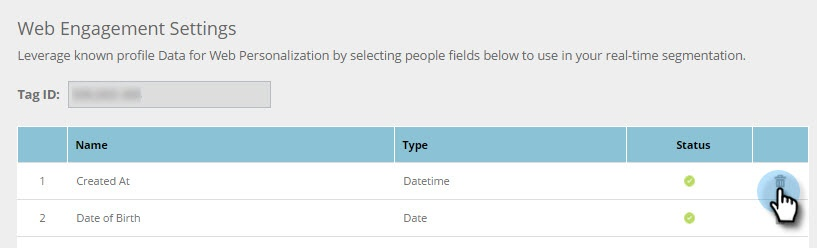

# Gérer les données de personne {#manage-person-data}

Tirez parti des données de personne pour les [!DNL Web Personalization] en sélectionnant les champs de personne à utiliser dans votre segmentation.

1. Accédez à **[!UICONTROL Paramètres du compte]**.

   

1. Accédez à **[!UICONTROL Base de données]**.

   

## Ajout d’un champ Personne {#adding-a-new-person-field}

1. Sélectionnez **Champ à ajouter** dans la liste déroulante pour ajouter un champ de données personne à la liste.

   

   >[!NOTE]
   >
   >Un nouveau champ est ajouté avec un statut En attente et son activation peut prendre jusqu’à 24 heures.

## Supprimer un champ de personne {#deleting-a-person-field}

1. Cliquez sur l’icône de suppression ( ) pour supprimer un champ de la liste. Cliquez sur **[!UICONTROL Oui]** pour confirmer la suppression du champ.

   

   >[!NOTE]
   >
   >**Gestion des champs de données de personne**
   >
   >* Seuls les champs de données Personne peuvent être inclus.
   >* Vous pouvez ajouter jusqu’à 30 champs de données Personne
   >* L’activation des nouveaux champs ajoutés peut prendre jusqu’à 24 heures.
   >* La longueur maximale de chaînes de caractères est de 255 caractères.
   >* Les champs masqués seront automatiquement supprimés

<table>
 <tbody>
  <tr>
   <th>
REST API Nom
</th>
   <th>
SOAP API Nom
</th>
   <th>
Nom convivial
</th>
  </tr>
  <tr>
   <td>
service
</td>
   <td>
Service
</td>
   <td>
Service
</td>
  </tr>
  <tr>
   <td>
titre
</td>
   <td>
Titre
</td>
   <td>
Intitulé du poste
</td>
  </tr>
  <tr>
   <td>
évaluation
</td>
   <td>
Évaluation
</td>
   <td>
Évaluation
</td>
  </tr>
  <tr>
   <td>
leadScore
</td>
   <td>
LeadScore
</td>
   <td>
Score
</td>
  </tr>
  <tr>
   <td>
leadStatus
</td>
   <td>
LeadStatus
</td>
   <td>
Statut
</td>
  </tr>
  <tr>
   <td>
priorité
</td>
   <td>
Priorité
</td>
   <td>
Priorité
</td>
  </tr>
  <tr>
   <td>
leadRole
</td>
   <td>
LeadRole
</td>
   <td>
Rôle
</td>
  </tr>
  <tr>
   <td>
désabonné
</td>
   <td>
Désabonné ou désabonnée
</td>
   <td>
Désabonné ou désabonnée
</td>
  </tr>
 </tbody>
</table>

Les champs de prospect suivants sont fournis prêts à l’emploi pour les nouveaux comptes [!DNL Web Personalization] :

>[!MORELIKETHIS]
>
>[Créer un segment à l’aide de données de personne connues](/help/marketo/product-docs/web-personalization/using-web-segments/create-a-segment-using-known-person-data.md)
