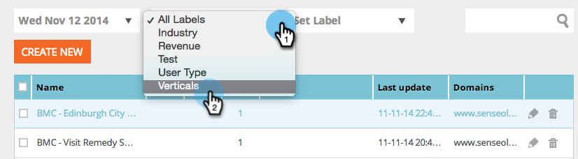
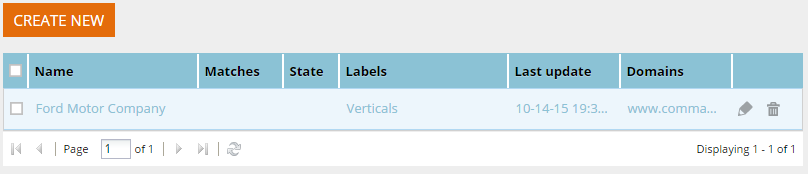

# Afficher des segments à partir d’un libellé spécifique {#view-segments-from-a-specific-label}

Vous souhaitez afficher et filtrer vos segments en fonction d’un libellé spécifique ?

## Filtrer selon les libellés existants {#filter-by-existing-labels}

Dans la liste déroulante des libellés, sélectionnez le libellé de votre choix.

Très cool. Notez que nous ne vous affichons maintenant que les segments associés au libellé sélectionné.

