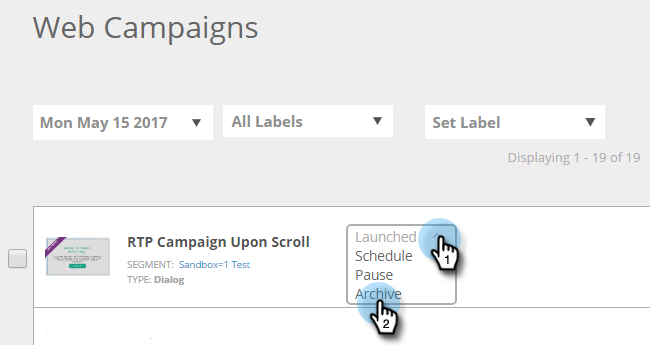

# Archiver une campagne web {#archive-a-web-campaign}

1. Accédez à **[!UICONTROL Campagnes web]**.

   

1. Cliquez sur le menu déroulant Statut de la campagne web souhaitée et sélectionnez **[!UICONTROL Archiver]**.

   

   >[!NOTE]
   >
   >Les campagnes web archivées ne s’affichent pas dans le filtre par défaut. Pour les afficher, cliquez sur l’icône Filtrer et sous **[!UICONTROL Statut]**, cochez la case **[!UICONTROL Archivé]** et cliquez sur **[!UICONTROL Appliquer]**.

>[!MORELIKETHIS]
>
>[Supprimer une [!UICONTROL campagne web]](/help/marketo/product-docs/web-personalization/working-with-web-campaigns/delete-a-web-campaign.md)
