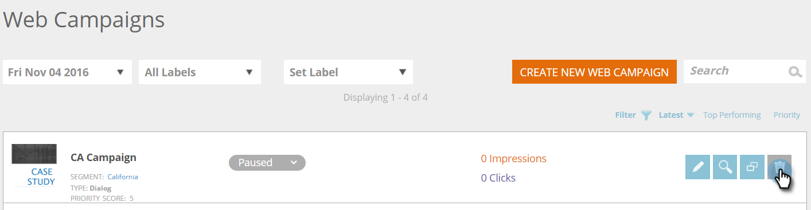

# Supprimer une campagne web {#delete-a-web-campaign}

1. Accédez à **[!UICONTROL Campagnes web]**.

   

   >[!NOTE]
   >
   >Pour faciliter la recherche de la campagne web souhaitée, utilisez la [fonction de filtre](/help/marketo/product-docs/web-personalization/working-with-web-campaigns/filter-web-campaigns.md).

1. Sur la page [!UICONTROL Campagnes web], cliquez sur **[!UICONTROL Supprimer]** sur la campagne à supprimer.

   

1. Un message de confirmation s’affiche pour confirmer la suppression de la campagne web.

>[!MORELIKETHIS]
>
>* [Modifier une campagne web](/help/marketo/product-docs/web-personalization/working-with-web-campaigns/edit-an-existing-web-campaign.md)
>* [Lancer/mettre en pause une campagne web](/help/marketo/product-docs/web-personalization/working-with-web-campaigns/launch-pause-a-web-campaign.md)
