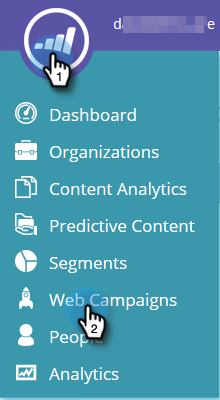
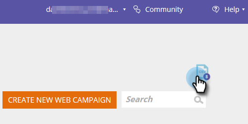
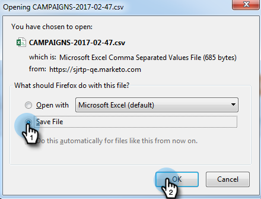
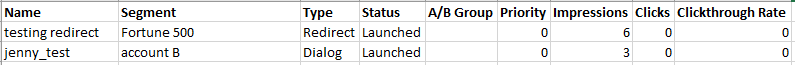

# Exporter les données de campagne web {#export-web-campaign-data}

Pour exporter les données de votre campagne web, procédez comme suit.

1. Accédez à **[!UICONTROL Campagnes web]**.

   

1. Dans le coin supérieur droit de la page, cliquez sur l’icône Exporter au format CSV .

   

1. Ouvrez ou enregistrez votre fichier.

   

1. Affichez votre fichier pour consulter des statistiques utiles.

   
