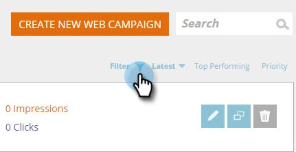
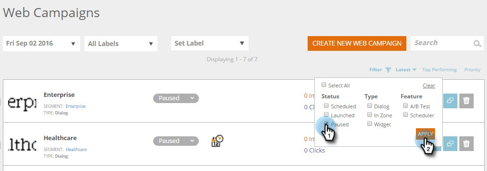
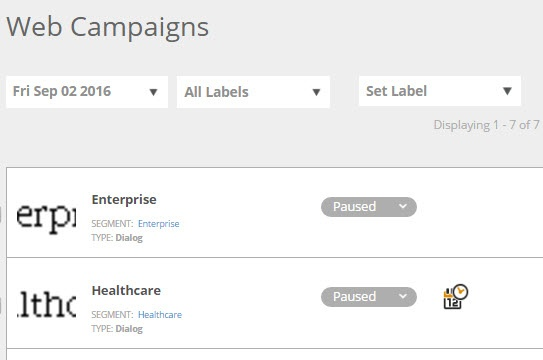

# Filtrer les campagnes web {#filter-web-campaigns}

Après avoir créé des centaines de campagnes [!DNL Web Personalization], il est vraiment utile de pouvoir utiliser des filtres pour afficher uniquement celles qui vous intéressent.

1. Accédez à **[!UICONTROL Campagnes web]**.

   

1. Sur la page [!UICONTROL  Campagnes web ], cliquez sur **[!UICONTROL Filtrer]**.

   

1. Cochez la case en regard du Statut et/ou du Type de campagne que vous souhaitez filtrer, par exemple **[!UICONTROL En pause]** ou **[!UICONTROL Boîte de dialogue]**. Cliquez sur **[!UICONTROL Appliquer]**.

   

   >[!TIP]
   >
   >Utilisez la case à cocher **[!UICONTROL Tout sélectionner]** pour tout sélectionner ou le lien **[!UICONTROL Effacer]** pour tout décocher.

1. Désormais, seules les campagnes correspondant à votre filtre s’affichent.

   

   Un morceau de gâteau !
