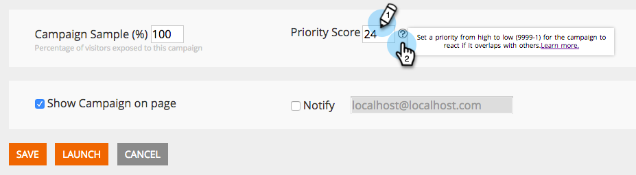
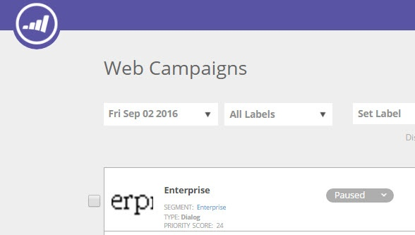

# Priorisation des campagnes web {#prioritizing-web-campaigns}

Hiérarchisez vos campagnes web lorsque plusieurs campagnes web se chevauchent en définissant un score de priorité.

>[!NOTE]
>
>**Campagnes qui se chevauchent**
>
>Un chevauchement de campagnes web se produit lorsque :
>
>* Plusieurs widgets et/ou campagnes de dialogue réagissent en même temps sur la même page
>* Réaction simultanée de plusieurs zones d’entrée avec le même ID de zone sur la même page web
>
>Une campagne Dans la zone et une campagne (widget ou boîte de dialogue) peuvent réagir sur la même page.

1. Accédez à **[!UICONTROL Campagnes web]**.

   

   >[!NOTE]
   >
   >Pour faciliter la recherche de la campagne web souhaitée, utilisez la [fonction de filtre](/help/marketo/product-docs/web-personalization/working-with-web-campaigns/filter-web-campaigns.md).

1. Dans la page Modifier la campagne , définissez le [!UICONTROL Score de priorité] (9999 = Priorité la plus élevée 1 = Priorité la plus faible).

   

   >[!TIP]
   >
   >Nous vous recommandons d’utiliser la campagne [!UICONTROL Score de priorité] uniquement s’il existe un chevauchement potentiel des campagnes, avec une importance plus élevée de l’une des campagnes. Il n’est pas nécessaire de définir une priorité pour chaque campagne.

1. Enregistrez ou lancez la campagne.

1. Reportez-vous au [!UICONTROL Score de priorité] affiché sur la page [!UICONTROL Campagnes web].

