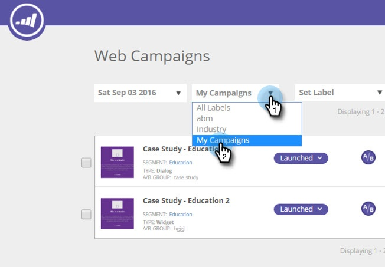
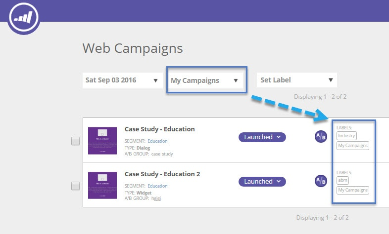

# Afficher les campagnes web à partir d’un libellé spécifique {#view-web-campaigns-from-a-specific-label}

Vous souhaitez afficher et filtrer vos campagnes en fonction d’un libellé spécifique ?

## Filtrer selon les libellés existants {#filter-by-existing-labels}

1. Accédez à **[!UICONTROL Campagnes web]**.

   

1. Dans la liste déroulante des libellés, sélectionnez le libellé de votre choix.

   

1. Notez que nous ne vous affichons que les campagnes associées au libellé sélectionné ?

   

>[!MORELIKETHIS]
>
>* [Étiqueter Vos [!UICONTROL Campagnes Web]](/help/marketo/product-docs/web-personalization/working-with-web-campaigns/label-your-web-campaigns.md)
>* [Affichage des segments à partir d’un libellé spécifique](/help/marketo/product-docs/web-personalization/using-web-segments/view-segments-from-a-specific-label.md)
>* [Étiqueter vos segments](/help/marketo/product-docs/web-personalization/using-web-segments/label-your-segment.md)
