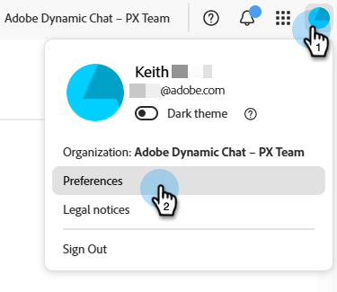
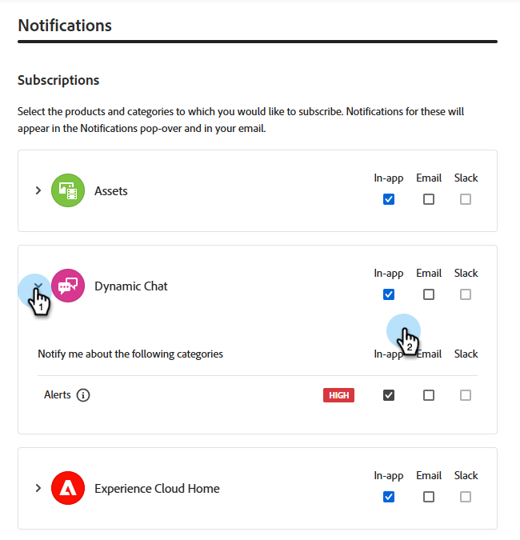

# Notes de mise à jour de Dynamic Chat {#dynamic-chat-release}

Les mises à jour d’Adobe Dynamic Chat fonctionnent sur un modèle de diffusion continue qui permet une approche plus évolutive du déploiement des fonctionnalités. Il arrive qu’il y ait plusieurs versions par mois. N’hésitez pas à vérifier régulièrement pour obtenir les informations les plus récentes.

La page Notes de mise à jour standard de Marketo Engage [peut être consultée ici](/help/marketo/release-notes/current.md){target="_blank"}.

## Version de juin 2025 {#june-2025-release}

### Réorganisation de la logique de transmission {#routing-logic-revamp}

Nous avons réorganisé la logique de transmission de la conversation en direct dans Dynamic Chat pour garantir un comportement d’engagement plus intelligent et plus prévisible pour tous les types de transmission (compte, personnalisé, équipe et round-robin). La nouvelle logique simplifie les flux de routage et améliore la gestion du fallback lorsque les agents ne sont pas disponibles.

#### Améliorations clés du comportement de la transmission

* **Jusqu’à deux tentatives d’engagement par session**

  * Le système tente de se connecter à un maximum de deux agents (au plus), mais strictement dans la règle de routage principale.

  * Si un agent est disponible mais ne répond pas (par exemple, refuse ou manque la conversation), le système tente de se connecter à un autre agent du même pool.

  * La logique de fallback (comme le « round-robin ») n’est activée que si aucun agent éligible n’est trouvé lors de la résolution initiale. Elle ne sert pas à faire une nouvelle tentative après un échec d’interaction.

* **Comportement spécifique à la règle de transmission**

_&#x200B;**Transmission du compte**&#x200B;_

Si le domaine d’e-mail d’un visiteur ou d’une visiteuse est mappé à un compte connu, l’agent mappé ou l’agente mappée conserve toujours la priorité.

Si l’agent est disponible, la conversation lui est directement adressée.

Si l’agent n’est pas disponible, le système :

* ne tente pas d’utiliser un autre agent ou une autre agente, même si le round-robin est activé comme solution de secours.

Au lieu de cela, il :

* Affiche le calendrier de réunion de l&#39;agent mappé (s&#39;il est activé) ou :
* renvoie à un message par défaut (dans le pire des cas).

La règle de routage au niveau de la carte (par exemple, Équipe, Personnalisé) n’est prise en compte que si le routage de compte n’est pas éligible (aucun domaine ou agent correspondant).

_&#x200B;**Routage personnalisé/d’équipe**&#x200B;_

Ces règles peuvent renvoyer plusieurs agents éligibles.

Si le premier agent disponible ne s&#39;engage pas, le système essaie un autre agent de la même liste.

La solution de secours round-robin n’est pas déclenchée parce qu’un agent ou une agente ne répond pas.

Si aucun agent ne s’engage :

* Le système affiche le calendrier du premier agent essayé (s&#39;il est activé),
-ou-
* Affiche le message de fallback par défaut.

_&#x200B;**Transmission du round-robin**&#x200B;_

Lorsqu’il est utilisé comme règle de transmission principale, le système :

* tente d’engager le premier agent ou la première agente disponible du pool du round-robin.

* Si le premier agent ou la première agente ne répond pas, il réessaye avec le meilleur choix éligible suivant.

Si le round-robin est utilisé comme solution de secours, il n’est activé que si aucun agent ni aucune agente ne ressort à partir de la règle principale.

_&#x200B;**Flux d’expérience du visiteur**&#x200B;_

Le système vérifie si la transmission du compte est applicable.

* Si oui, et si l’agent ou l’agente est disponible, il se connecte immédiatement.

* Si l’agent n’est pas éligible ou n’est pas disponible, le système passe à la règle de routage au niveau de la carte.

Les règles de routage au niveau de la carte (personnalisée, d’équipe, à tour de rôle) ont été évaluées.

* La disponibilité (autorisations, statut) des agentes et agents éligibles est vérifiée.

* Le système engage un agent et, si nécessaire, tente un deuxième agent à partir de la même règle.

* Si aucun engagement ne réussit, la logique de secours est appliquée :

  * Calendrier de secours (si activé),
    -ou-
  * message par défaut.

La solution de secours du round-robin n’est prise en compte que lorsqu’aucun agent ni aucune agente éligible n’est disponible dans la règle de transmission principale, et non lorsque des agentes et agents individuels ne répondent pas.

##### Cas d’utilisation {#use-cases}

_&#x200B;**Transmission du compte**&#x200B;_

<table><thead>
  <tr>
    <th>Type</th>
    <th>Exemple</th>
    <th>Résultat</th>
  </tr></thead>
<tbody>
  <tr>
    <td>Idéal</td>
    <td>Le domaine du visiteur ou de la visiteuse est mappé à un compte ; la conversation en direct est activée pour l’agent mappé ou l’agente mappée, qui est disponible.</td>
    <td>La conversation se connecte directement à l’agent mappé ou à l’agente mappée.</td>
  </tr>
  <tr>
    <td>Solution de secours (type round-robin)</td>
    <td>L’agent mappé n’est pas disponible, la solution de fallback de type « round-robin » est activée.</td>
    <td>Le système sélectionne un agent disponible à tour de rôle et l’engage </td>
  </tr>
  <tr>
    <td>Aucun agent ni aucune agente de secours</td>
    <td>L’agent mappé ou l’agente mappée n’est pas disponible, pas de solution de secours round-robin ; la réservation de réunion est activée.</td>
    <td>Le système affiche le calendrier d’un agent mappé ou affiche un message de secours par défaut</td>
  </tr>
</tbody></table>

_&#x200B;**Transmission personnalisée**&#x200B;_

<table><thead>
  <tr>
    <th>Type</th>
    <th>Exemple</th>
    <th>Résultat</th>
  </tr></thead>
<tbody>
  <tr>
    <td>Idéal</td>
    <td>La logique personnalisée renvoie une liste d’agents ; le premier agent est disponible et accepte la conversation.</td>
    <td>La conversation se connecte au premier agent ou à la première agente.</td>
  </tr>
  <tr>
    <td>Solution de secours (type round-robin)</td>
    <td>La règle personnalisée ne résout aucun agent. La fonction de secours Round Robin est activée.</td>
    <td>Le système sélectionne un agent disponible à tour de rôle et l’engage.</td>
  </tr>
  <tr>
    <td>Aucun agent ni aucune agente de secours</td>
    <td>Deux agentes et agents ont été résolus ; aucun n’accepte la conversation, la solution de secours est définie sur le calendrier de réunion.</td>
    <td>Première tentative : le calendrier de l’agent s’affiche ou le message de secours par défaut s’affiche.</td>
  </tr>
</tbody></table>

_&#x200B;**Transmission d’équipe**&#x200B;_

<table><thead>
  <tr>
    <th>Type</th>
    <th>Exemple</th>
    <th>Résultat</th>
  </tr></thead>
<tbody>
  <tr>
    <td>Idéal</td>
    <td>L’équipe comprend des agents qui utilisent la conversation en direct ; le premier agent disponible accepte la conversation.</td>
    <td>La conversation est attribuée à cet agent.</td>
  </tr>
  <tr>
    <td>Solution de secours (type round-robin)</td>
    <td>Aucun agent de l’équipe n’est disponible et la solution de fallback « Round Robin » est activée.</td>
    <td>Le système sélectionne un agent du pool Round Robin et s'y connecte.</td>
  </tr>
  <tr>
    <td>Aucun agent ni aucune agente de secours</td>
    <td>Deux agentes et agents disponibles, mais pas de contact établi ; le calendrier de secours est activé.</td>
    <td>Première tentative d’affichage du calendrier de l’agent ou de déclenchement d’un message de secours.</td>
  </tr>
</tbody></table>

_&#x200B;**Transmission du round-robin**&#x200B;_

<table><thead>
  <tr>
    <th>Type</th>
    <th>Exemple</th>
    <th>Résultat</th>
  </tr></thead>
<tbody>
  <tr>
    <td>Idéal</td>
    <td>Round Robin pool a plusieurs agents ; le deuxième agent accepte le chat après le premier ne le fait pas.</td>
    <td>La conversation se connecte à un second agent.</td>
  </tr>
  <tr>
    <td>Solution de secours (type round-robin)</td>
    <td>Aucun agent ni aucune agente disponible dans la sélection du round-robin ; le calendrier des réunions est activé.</td>
    <td>Le calendrier s’affiche pour le premier agent de la liste (s’il est configuré) ou le message de secours s’affiche.</td>
  </tr>
  <tr>
    <td>Aucun agent ni aucune agente de secours</td>
    <td>Aucun agent ni aucune agente disponible ; la solution de secours est désactivée.</td>
    <td>Un message de secours statique s’affiche pour le visiteur.</td>
  </tr>
</tbody></table>

### Notification Pulse {#pulse-notification}

Chaque fois qu’un visiteur demande à se connecter à un agent, nous lui fournissons une notification in-app via le navigateur. Mais il arrive parfois que les agents manquent ces demandes de conversation.

Avec cette version, l’agent ou l’agente en direct peut recevoir une notification e-mail, Slack, in-app ou dans son navigateur lorsqu’un nouveau visiteur ou une nouvelle visiteuse souhaite discuter.

1. Sur la page d’accueil d’Adobe Experience Cloud, cliquez sur l’icône Compte et sélectionnez **Préférences**.

   

1. Faites défiler jusqu’à _Notifications_ et sélectionnez les options Dynamic Chat souhaitées.

   

>[!NOTE]
>
>Le contenu d’une notification Pulse peut être le même que celui que nous utilisons pour les notifications in-app ou de navigateur.
